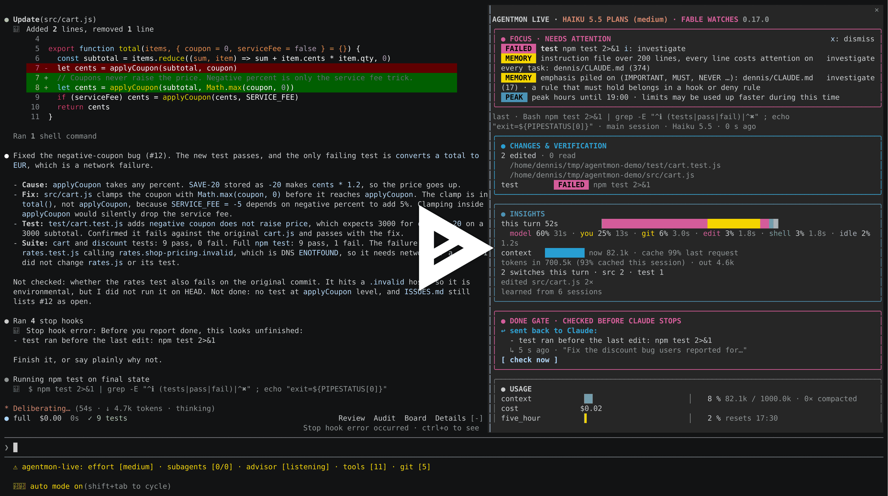

<p align="center">
  
</p>

<h1 align="center">AgentMon Live</h1>

<p align="center"><b>See what Claude Code is doing while it works. Catch "done" before it is done.</b></p>

<p align="center">A live pane beside the chat for Claude Code: the session, its tools and subagents at a glance, plus a gate that stops Claude from reporting work as finished when it is not.</p>

```
AGENTMON LIVE · OPUS 5.5 PLANS (high)
╭──────────────────────────────────────────────────────────────╮
│ ● FOCUS · NEEDS ATTENTION                         x: dismiss │
│  FAILED  test npm test                       i: investigate  │
╰──────────────────────────────────────────────────────────────╯
╭──────────────────────────────────────────────────────────────╮
│ ● CHANGES & VERIFICATION                                     │
│ 3 edited · 7 read                                            │
│ test         FAILED  npm test                                │
╰──────────────────────────────────────────────────────────────╯
╭──────────────────────────────────────────────────────────────╮
│ ● USAGE                                                      │
│ context   ▕████▋               ▏  19 % 190k / 1000k          │
│ seven_day ▕██████████████▌     ▏  77 % resets 15:00          │
╰──────────────────────────────────────────────────────────────╯
h: history   d: details
```

[](https://asciinema.org/a/1270436)

## Why you want it

- **No more "all tests pass" when they don't.** Before Claude stops, the done gate checks what really happened: failed or stale tests, open todos, failing subagents. Anything unfinished goes back to Claude once. Fable, a second model that never writes code, checks that every part of your request got an answer.
- **One glance, not a scroll.** Running tool calls, subagents, edited files and the last test, lint and build results sit in one pane.
- **It tells you when to step in.** Focus raises what needs you: a waiting approval, a failure loop, context near compaction, a stuck subagent, a cold prompt cache. Press `i` and it drafts the follow-up question for you.
- **Spend less.** See where time and tokens go, which MCP servers you load but never use, and when `/clear` or `/compact` would save you money.
- **It learns your project.** It remembers flaky tools, compaction points and heavy habits across sessions, and checks your CLAUDE.md and memory files for drift.
- **Proof, not vibes.** `/agentmon bench` compares your sessions with and without the mod.

Speaks English, German, French, Spanish, Chinese and Japanese.

## Install

Requires Claude Code 2.1.308 or later. In a Claude Code session:

```
/plugin install agentmon-live --marketplace codenotary/agentmon-live
```

Answer `y` to add the marketplace and pick a scope. The pane opens by itself when the terminal is wide enough, or with `/agentmon`.

<details>
<summary>From a shell, the desktop app, or let Claude do it</summary>

```sh
claude plugin install agentmon-live --marketplace codenotary/agentmon-live
```

Desktop app: click + next to the prompt box, then Plugins, Add marketplace with `codenotary/agentmon-live`, then Add plugin.

Or paste this into a Claude Code session:

```
Install the Claude Code plugin agentmon-live from the marketplace codenotary/agentmon-live
(claude plugin install agentmon-live --marketplace codenotary/agentmon-live). Then ask me which
language I want (en, de, fr, es, zh, ja) and which advisor mode (all, gate, off), and set
those options for the plugin in my user settings. Tell me to restart Claude Code when done.
```

</details>

## Make it yours

Just ask Claude: *"hide the usage box"*, *"switch AgentMon to German"*, *"turn the done gate off"*. Then run `/reload-plugins`. Or set the options in `/config`.

| Key | Does |
| --- | --- |
| `i` | Draft a question about the top Focus item |
| `u` | Draft the update commands, when a new release is out |
| `l` | Show the new release's changelog |
| `x` | Put Focus items away |
| `d` | Show everything, uncut |
| `h` | Fold the history |
| `c` | Run the done-gate check now |

Commands: `/agentmon`, `advisor`, `check`, `learn`, `memory`, `bench`, `clear`.

## More

- [Guide](docs/guide.md): every section of the pane, all commands and options, the done gate, the file-size guide, learning and the self benchmark.
- [Develop](docs/develop.md): build, test, and see the real pane from a script.

Developed by [vchaindz](https://github.com/vchaindz). [Apache License 2.0](LICENSE).
