<p align="center">
  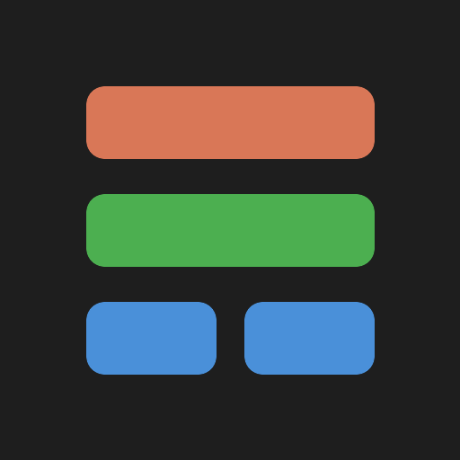
</p>

<h1 align="center">AgentMon Live</h1>

<p align="center"><b>See what your AI agents are really doing.</b></p>

<p align="center">Watch Claude Code and its subagents work, live in your browser or beside the chat. See what it costs, how close you are to your limits, and when it needs you. AgentMon also checks Claude's work before it says "done". <a href="#kiro-crew">Kiro Crew</a> chats show in the same page, on any harness.</p>

<p align="center">
  
  <a href="LICENSE"></a>
</p>

<p align="center"><a href="#install">Install</a> · <a href="#kiro-crew">Kiro Crew</a> · <a href="#why-you-want-it">Why you want it</a> · <a href="#the-pane">The pane</a> · <a href="#the-web-view">The web view</a> · <a href="#cost-and-privacy">Cost and privacy</a> · <a href="#make-it-yours">Make it yours</a> · <a href="#more">More</a></p>

**Press `o` and your session opens in the browser.** See who started whom, what each agent does right now, and where the money goes. [See all of it](#the-web-view).

[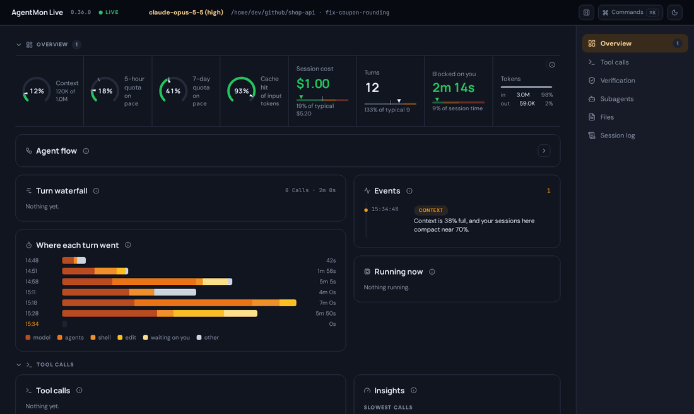](#the-web-view)

## Install

In a Claude Code session (2.1.308 or later):

```
/plugin install agentmon-live --marketplace codenotary/agentmon-live
```

Answer `y` to add the marketplace and pick a scope. There is nothing to set up. The pane opens by itself when the terminal is wide enough, or with `/agentmon`.

<details>
<summary>From a shell, the desktop app, or let Claude do it</summary>

```sh
claude plugin install agentmon-live --marketplace codenotary/agentmon-live
```

Desktop app: click + next to the prompt box, then Plugins, Add marketplace with `codenotary/agentmon-live`, then Add plugin.

Or paste this into a Claude Code session:

```
Install the Claude Code plugin agentmon-live from the marketplace codenotary/agentmon-live
(claude plugin install agentmon-live --marketplace codenotary/agentmon-live). Tell me to restart
Claude Code when done.
```

</details>

### Kiro Crew

The web view lists every open [Kiro Crew](https://kiro.dev) chat beside your Claude Code sessions, whatever harness the chat runs on (kiro-cli, Claude Code, Codex and the others). It reads the log Kiro Crew writes, so this needs nothing installed in Kiro Crew: open the web view and the chats are there.

To have AgentMon start with Kiro Crew and show in a tab beside the chat, install this repo as a Kiro Crew app. It needs `node`.

<details>
<summary>Install from a clone</summary>

```sh
git clone https://github.com/codenotary/agentmon-live
kirocrew app install <path>/agentmon-live
```

</details>

Then turn it on in Kiro Crew:

1. Open **Library** in the left bar. AgentMon Live is listed under **Disabled**: click **Enable**. Kiro Crew asks you to trust the app before its code runs. That code is [`kiro/hooks.py`](kiro/hooks.py), about 100 lines of standard-library Python that run with Kiro Crew's own rights and start the web view's server. Read it before you say yes.

   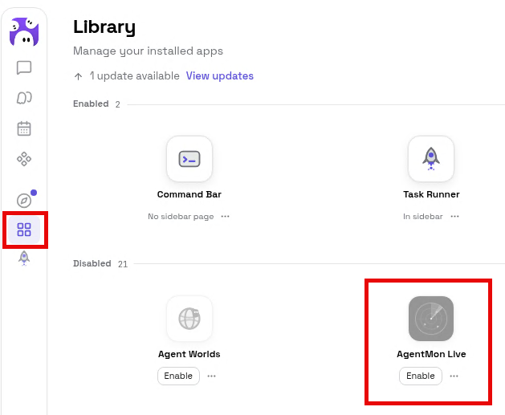

2. Open a chat, click **+** above the side panel and pick **AgentMon Live**.

   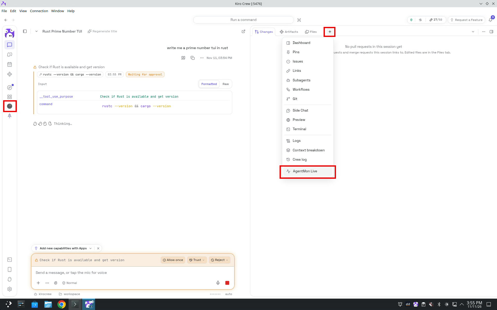

3. The tab shows the chat live: where each turn went, tool calls, files, the session log. The tab works on Linux and macOS.

   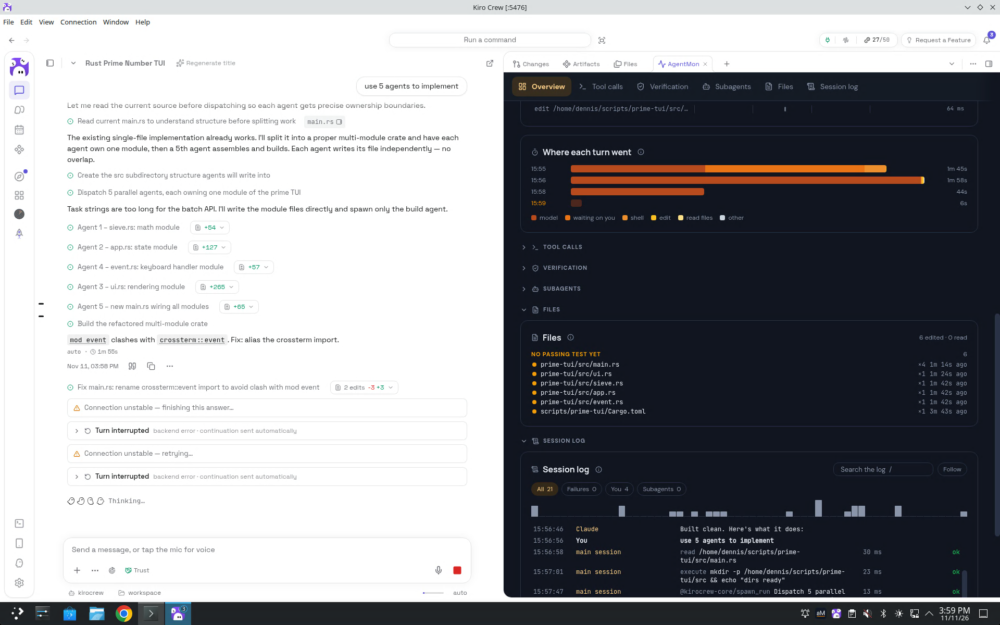

- **What you see:** turns with their time split, tool calls with duration and result, waiting approvals and time blocked on you, subagents and the files they wrote, events and insights, the task list, the context gauge, prompts and answers. kiro-cli reports credits, so the cost tile reads **Credits** and tokens stay empty.
- **What stays empty:** the done gate, Focus, verification and learning. Those come from the plugin inside a Claude Code session.
- **To remove it:** `kirocrew app uninstall agentmon-live`.

The [guide](docs/guide.md#web-view) has the rest, including a registry install from Kiro Crew's settings.

## Why you want it

- **See it happen.** Every agent, tool call and handoff, live in your browser, in the [agent flow](#overview).
- **Don't run out.** Cost, context and quota limits at a glance, and when `/clear` or `/compact` would save you money.
- **Know when to step in.** It raises a waiting approval, a stuck subagent or a failure loop. Press `i` and it drafts the follow-up question for you.
- **Trust "done".** Claude says all tests pass? AgentMon checks, and sends it back if they don't.
- **It learns your project.** It remembers flaky tools and recurring errors across sessions, and spots drift in your CLAUDE.md.
- **Measure it.** `/agentmon bench` compares your sessions with and without AgentMon.

Speaks English, German, French, Spanish, Chinese and Japanese, and follows your terminal's language. The [guide](docs/guide.md) has the details, including everything the done gate checks.

## The pane

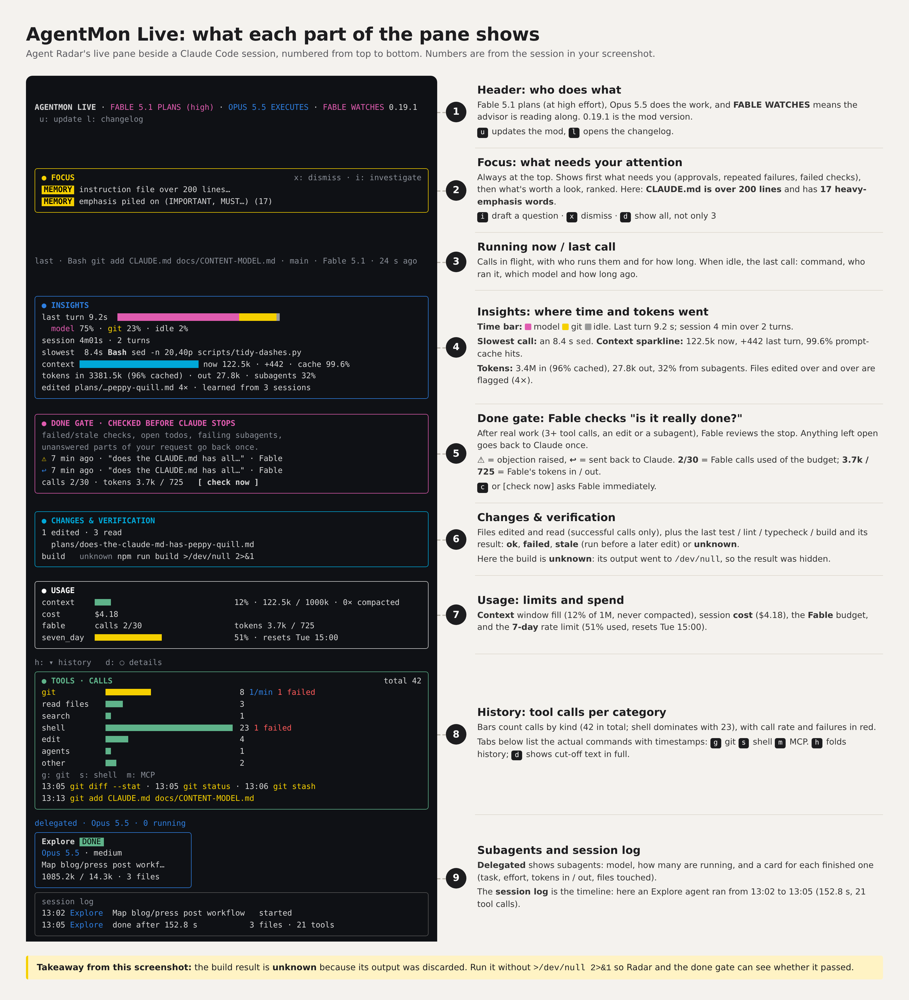

[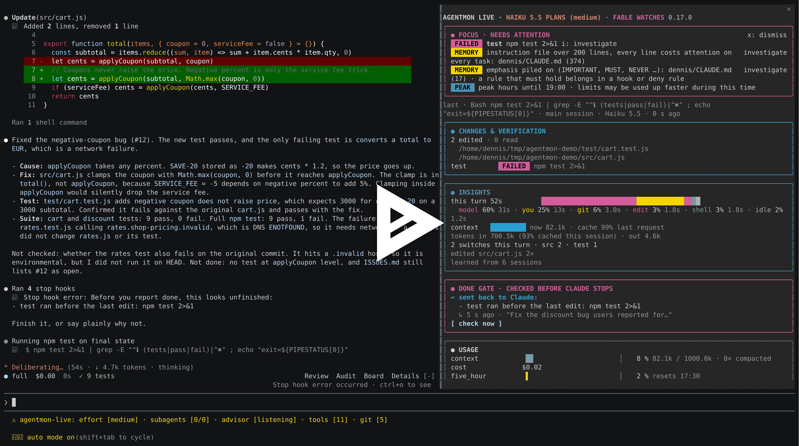](https://asciinema.org/a/1270436)

## The web view

Press `o`, or run `/agentmon open`. It needs `node` on your `PATH`, which Claude Code does not include; everything else works without it. It is local only, and the one thing it can change is showing or hiding the pane.

One page, with a rail that moves between its sections: [Overview](#overview) · [Tool calls](#tool-calls) · [Verification](#verification) · [Subagents](#subagents) · [Files](#files) · [Session log](#session-log). Each section folds, each widget has an `i` that explains it, and every running session is one click away in the top bar. Open [Kiro Crew](#kiro-crew) chats show there too. The pictures show a made-up session.

### Overview

Context, quotas, cache hits, cost and turns measured against their limits or your usual sessions, coloured good or bad. Pins move on a change and shake slightly while the page is connected.

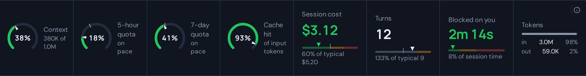

The agent flow shows who started whom, when each subagent handed back, the messages agents sent each other, and where a call failed. Dashed lanes are still running; dotted verticals are check runs, such as tests. Drag the strip on top to pick a time, or press 1, 5 or 15 min, and the waterfall below follows it.

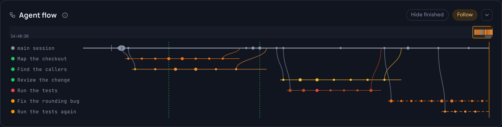

The waterfall shows every call in that time, nested under the agent that made it. Beside it are what needs you, with buttons for failures, waiting, context and memory, and what runs now, and below it where each turn's time went.

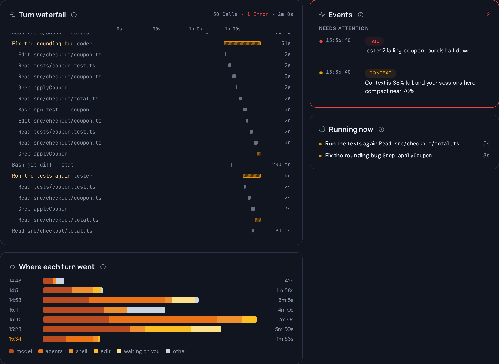

### Tool calls

Every tool call, sortable, with filters by tool (one per MCP server), by agent and for failures. Click a row for its details. Insights lists the slowest calls, the largest results and approvals asked more than once.

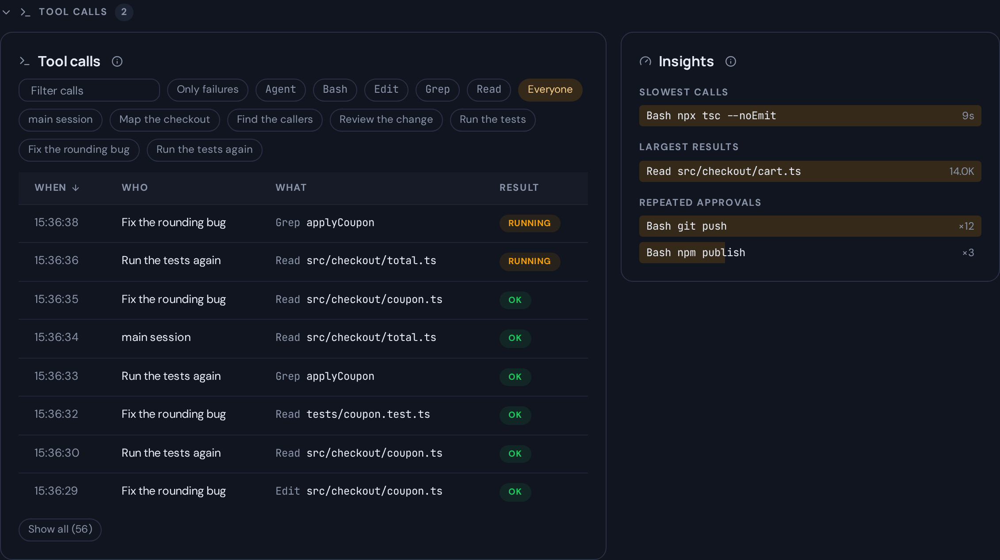

### Verification

The last test, type check, lint and build, files changed since the last passing test, and test files whose checks were removed or changed; other edited test files are only counted. Tasks sit beside them.

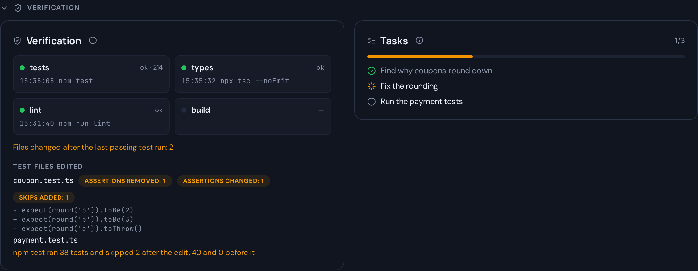

### Subagents

One row per subagent, worst first, ten at a time plus every running one. Health dots compare its duration, tokens and errors with the session's other subagents. Click a row for its prompt and calls.

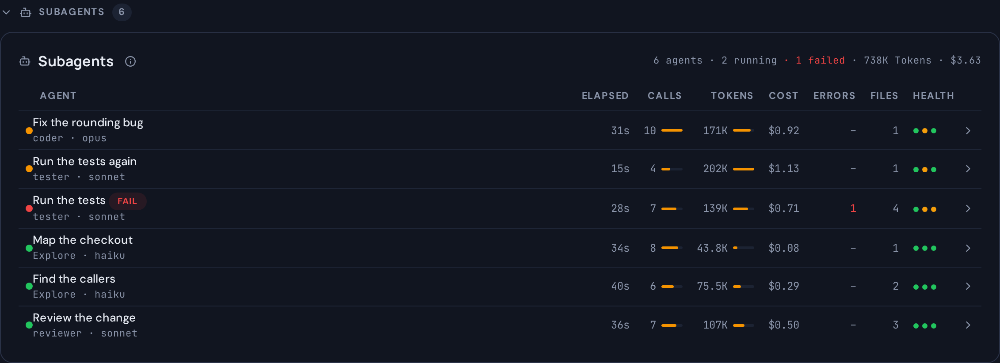

### Files

Edited files, paths inside the project, grouped by whether they still need a test: not tested since the last passing run, then edited before it. Files only read follow, most read first.

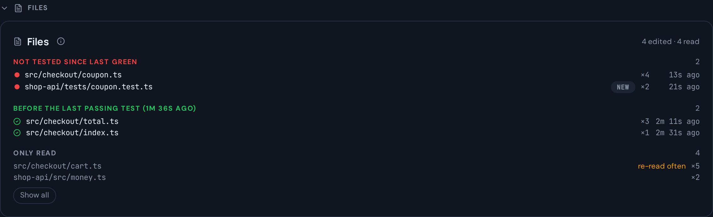

### Session log

One searchable stream of your prompts, Claude's answers, tool calls and subagents. A subagent is one row that unfolds to its calls, equal calls merge, and a failed call keeps its own red row. Filter with the buttons, or click a red bar to go to that failure.

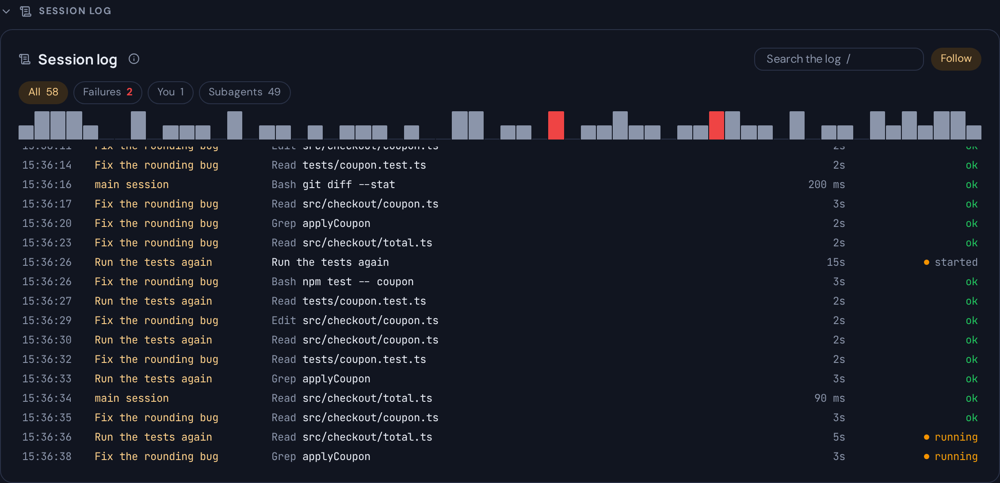

## Cost and privacy

- **Your session stays on your machine.** The web view listens on `127.0.0.1` only, and what AgentMon learns is kept in Claude Code's local plugin store. Secrets are masked before they are shown.
- **The web view is yours alone.** On Linux and macOS the server asks the system which account a browser runs as and lets only yours in: you open the address and type nothing, also through an SSH port forward. On Windows AgentMon opens the page with a one-time code (`o` or `/agentmon open`), and the browser keeps its pass until the server stops. Sessions and server prove to each other that they belong to your account, with a secret that never leaves `~/.claude/agentmon-live/web.token`. `webToken: off` turns all of this off; see the [guide](docs/guide.md#web-view) for the limits.
- **Kiro Crew chats are read, not changed.** The server reads Kiro Crew's log files under `~/.kiro/crew/` and sends nothing to Kiro Crew. Only Kiro Crew's own page may frame the web view, and only while Kiro Crew runs.
- **One optional model call.** Before Claude stops, Fable, a second model, may check that every part of your request got an answer and that nothing you did not ask for got built: a small call with about 12,000 characters of session text, at most 30 per session by default. Set `advisorMode` to `gate` for no model calls at all.
- **One network check.** It asks GitHub for the latest release. No session data goes with it.

To remove it: `claude plugin uninstall agentmon-live`.

## Make it yours

Just ask Claude: *"hide the usage box"*, *"switch AgentMon to German"*, *"turn the done gate off"*. It takes effect at once, with no reload. Or edit `pluginConfigs` in `~/.claude/settings.json` yourself; that applies at your next prompt. The options are not in `/config`. See the [guide](docs/guide.md) for all of them.

<details>
<summary>All keys</summary>

| Key | Does |
| --- | --- |
| `i` | Draft a question about the top Focus item, or the slowest call |
| `u` | Draft the update commands, when a new release is out |
| `l` | Show the new release's changelog |
| `x` | Put Focus items away |
| `d` | Show long lists and texts whole |
| `h` | Fold the history |
| `a` | Fold out all running subagents, past four |
| `v` | Switch between the calm and classic layout |
| `o` | Open the web view in your browser |
| `p` | Hide the pane; a button above the prompt brings it back |
| `c` | Run the done-gate check now |

</details>

Commands: `/agentmon`, `advisor`, `check`, `open`, `learn`, `memory`, `bench`, `debug`, `clear`.

## More

- [Guide](docs/guide.md): every section of the pane, all commands and options, the done gate, the file-size guide, learning, the debug log and the self benchmark.
- [Develop](docs/develop.md): build, test, and see the real pane from a script.

Developed by [vchaindz](https://github.com/vchaindz). [Apache License 2.0](LICENSE).
