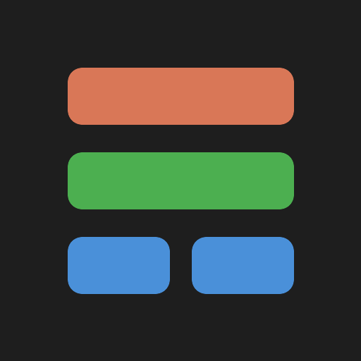

<p align="center">
  
</p>

<h1 align="center">AgentMon Live</h1>

<p align="center">A Claude Code plugin that keeps a live pane beside the chat, so you can see what the session and its subagents are doing while they work.</p>

## What it shows

Top to bottom, in the order you need it:

- **Focus** (always on top, in every view): first what needs you (a tool call waiting for your approval, three failed calls in a row, a failed check, a subagent that failed or reported failing tests, a subagent waiting), then what is worth a look, ranked by importance: a call running far longer than that tool usually takes, a subagent quiet for minutes, the same call failing again and again, context near compaction or one tool result that flooded it, a file read over and over or edited over and over, approvals holding up the turn (with the calls asked most, to turn into allow rules), a low prompt-cache hit rate, focus jumping between many parts of the project, one tool category eating most of the turn, MCP tool schemas taking a large slice of the window, a plan window (5h, 7d) filling faster than it resets, a large session (150k+ tokens) idle past its one-hour prompt cache, and peak hours (weekdays 05:00–11:00 Pacific), when usage counts more toward the weekly limit. Three show at once (`d` shows all); `i` drafts a question about the first one that has one, `x` puts them away. When nothing needs a look it is one line: where the last turn's time went.
- **Insights:** where the time went, this turn and over the session, as one bar: the model streaming, each tool category (parallel calls share the time), you (calls waiting on an approval) and idle; the slowest calls (approval waits left out); the main context per model request as a sparkline, its growth in the last turn, the prompt-cache hit rate and the biggest tool results (≈ characters / 4); tokens in, cached and out, and the subagents' share; how often the main loop moved between parts of the project this turn, and the files it re-read or re-edited most. With details on, the window's breakdown by category (from a local estimate, no extra request), MCP schema and CLAUDE.md tokens, and model or effort switches.
- **Running now:** each tool call in flight, with who runs it and for how long; when idle, the last call. Running and waiting subagents sit here as cards.
- **Done gate:** when Claude is about to stop after real work (3 or more tool calls, an edit, or a subagent), it checks what the session recorded: a test, lint, typecheck or build that failed this turn, one that ran before the last edit, todo items still open, a subagent that reported failing tests. Anything found goes back to Claude, once per prompt, as a Stop hook block: "Before you report done, this looks unfinished: … Finish it, or say plainly why not." Only when the facts show nothing does Fable, a second model that never writes code, judge one thing: does the final answer address every part of the request? The box reads `✓ nothing left open at the last stop`, `↩ sent back to Claude:` with the gaps, or `⚠ stopped with this left open:` when Claude stopped again with gaps; `f` then drafts the same reason as a prompt. Each result names when it came and the request it is about (`↳ 2 min ago · "fix the parser"`) and leaves when your next turn starts. It does not block while subagents run, after another Stop hook already sent the turn back, or when off. **Check now** (`c`, or `/agentmon check`) runs the same check and only shows it; while a turn runs, it waits for the turn's answer. Its state reads checking, off, checks only, unavailable (Fable failed; Claude then stops as usual) or budget used, with Fable's call count and tokens.
- **Changes and verification:** files edited and read (successful calls only), and the last test, lint, typecheck and build command with its outcome: ok, failed, or unknown when a pipe or a denial hides the exit status. A check run before a later edit is marked stale.
- **Usage:** context, cost and rate limits with their reset times; `unavailable` where the session does not report a value.
- **History** (folds with `h`): main session, tool counts per category with errors, the git / shell / MCP detail tabs (`g` `s` `m`, a click, or `/agentmon git|shell|mcp`), finished subagent cards and the session log.
- **Details** (`d`) shows cut-off tasks, commands and error texts whole.

Subagent test results are *reported* from the agent's final answer (a failure wins over a pass). Running and waiting subagents are always kept; the last 12 finished ones stay. The status line counts git commands as `git [n]`.

Languages: English (default), German, French, Spanish, Chinese and Japanese.

## Install

Requires Claude Code 2.1.308 or later.

At the prompt of a Claude Code terminal session:

```
/plugin install agentmon-live --marketplace codenotary/agentmon-live
```

Answer `y` to add the marketplace, then pick a scope. From a shell:

```sh
claude plugin install agentmon-live --marketplace codenotary/agentmon-live
```

In the desktop app: click + next to the prompt box, then Plugins, Add marketplace with `codenotary/agentmon-live`, then Add plugin.

### Or let Claude set it up

Paste this into a Claude Code session:

```
Install the Claude Code plugin agentmon-live from the marketplace codenotary/agentmon-live
(claude plugin install agentmon-live --marketplace codenotary/agentmon-live). Then ask me which
language I want (en, de, fr, es, zh, ja) and which advisor mode (all, gate, off), and set
those options for the plugin in my user settings. Tell me to restart Claude Code when done.
```

## Use

| Command | Does |
| --- | --- |
| `/agentmon` | Opens the pane |
| `/agentmon advisor` | Turns the done gate on or off |
| `/agentmon check` | Runs the done gate's check now, without sending anything |
| `/agentmon git`, `shell`, `mcp` | Shows that detail tab |
| `/agentmon flow`, `radar` | Switches the view (`v` in the pane) |
| `/agentmon details` | Shows cut-off texts whole (`d` in the pane) |
| `/agentmon learn [dir]` | Learns from this project's past transcripts (or the `.jsonl` files in `dir`) |
| `/agentmon memory` | Checks the memory and instruction files now and lists what it found |
| `/agentmon clear` | Resets counters, finished cards, log and the done gate's results; running subagents stay. The word for clear in each language works too: `leeren`, `vider`, `limpiar`, `清空`, `クリア` |

The pane opens by itself at session start when the terminal is wide enough.

## Options

Set in `/config`, under the plugin:

| Option | Values | Default |
| --- | --- | --- |
| `language` | `en`, `de`, `fr`, `es`, `zh`, `ja` | `en` |
| `advisorModel` | any model id | `claude-fable-5-1` |
| `advisorMode` | `all` (done gate with Fable's coverage check), `gate` (done gate from recorded facts only, no model), `off`; `plan` is read as `gate` | `all` |
| `advisorBudget` | most Fable calls per session; `0` for no limit | `30` |
| `sizeLimit` | bytes a maintained source file may reach before Focus suggests splitting it; `0` turns the guide off | `20000` |
| `sizeExclude` | comma-separated globs the size guide skips, on top of the built-in ones | empty |
| `learning` | `on` keeps what each session of a project shows (below); `off` keeps nothing | `on` |

### Cost

Fable is asked at most once per stop, and only when the recorded facts show no gap: one small model call (low effort, at most 300 output tokens, about 12,000 characters of material). `advisorBudget` caps the calls per session, and the pane shows Fable's own tokens. Set `advisorMode` to `gate` for no model calls at all.

### File-size guide

Big files are hard to take in, for people and for agents alike. When an Edit or Write, by the main session or a subagent, leaves a maintained source file over `sizeLimit` bytes (20,000 by default, about 5,000 tokens; a size heuristic, not a token count), Focus says so. Its `investigate` draft asks to split the file along distinct responsibilities with clear interfaces between the parts, and not to split arbitrarily or add abstractions just to get under the number. A file that was already over the limit is flagged only when it grows; a new file over the limit is flagged at once. It only warns; nothing is blocked.

Only source files count (`.ts`, `.py`, `.go`, `.rs` and the like), and only inside the project. Built-in exclusions skip lockfiles (`package-lock.json`, `yarn.lock`, `Cargo.lock`, `go.sum`, …), generated code (`*.min.*`, `*.map`, `*.generated.*`, `*.pb.go`, `generated/`), vendored code (`node_modules/`, `vendor/`, `third_party/`), build output (`dist/`, `build/`, `out/`, `target/`, `.next/`, `coverage/`) and fixtures (`fixtures/`, `__snapshots__/`, `testdata/`, `*.snap`). Add your own with `sizeExclude`.

For a file that should stay whole, add it to `.agentmon-size` at the project root, one glob per line with the reason after `#`. A line without a reason is ignored, so every exception says why:

```
src/schema.ts      # one table per type; kept together on purpose
src/legacy/*.ts    # ported code, split after the migration
```

### Learning across sessions

At the end of each turn the mod keeps a small record of the session, per project, in its own store: tool calls and errors per tool, results of 10k+ tokens, where the context compacted, and the MCP servers loaded. The last 30 sessions count. `/agentmon learn` fills that history from the project's past transcripts once. From it, Focus suggests; it never changes anything itself:

- **plan**: the context nears where past sessions compacted (90% of that point; with no history, 70% of the window). It names `/compact <focus>`, a lower effort when effort is high, and `/model sonnet` on a large model.
- **flaky**: a tool that failed in at least 25% of 10 or more calls over 3 or more sessions, with its last error. Its first call in a session also gives a toast.
- **unused**: an MCP server loaded in 5 or more sessions and never called, with the schema tokens it costs each time.
- **habit**: a tool that put 10k+ tokens into context 4 or more times over 3 or more sessions.
- **memory**: the memory and instruction files the session loads, plus the project's auto-memory folder, checked at start and after each edit of one. It finds a memory name used twice, MEMORY.md entries without a file and files without an entry, backticked paths that no longer exist (a `/api/...` route whose top folder is not on disk does not count), files over about 10k tokens and lines copied between files.


```sh
git clone https://github.com/codenotary/agentmon-live.git
cd agentmon-live
claude --plugin-dir .
```

Loading the mod once writes the types `tsconfig.json` extends into `.claude-plugin/types/` (git ignores that folder). Then:

```sh
claude plugin validate .
claude plugin test .
npx -p typescript tsc --noEmit -p .
```

| Path | Holds |
| --- | --- |
| `hooks/register.tsx` | Hooks, state and the pane |
| `hooks/insights.ts` | The Focus rules and their thresholds, time and context helpers |
| `hooks/learn.ts`, `hooks/learning.ts` | What is learned across sessions: the pure rules, and the store and commands |
| `hooks/memcheck.ts` | The memory-file rules |
| `hooks/i18n.ts` | All text, one block per language |
| `types/index.d.ts` | State contract |
| `tests/agentmon.test.tsx` | Tests |

### See the pane from a script

`claude plugin test` checks what the pane draws but never paints it. `scripts/pane-run.sh` runs a second Claude Code with this repo's mod (cheap model, a throwaway project with one failing and one passing check) in a hidden 220×60 tmux window, drives it from a scenario and saves the real screen:

```sh
scripts/pane-run.sh tests/scenarios/basics.txt      # add --keep to tmux attach afterwards
```

Captures land in `tests/pane-snaps/<scenario>/`: `<name>.txt` (whole screen), `<name>.pane.txt` (the pane alone), `<name>.ansi` (with colours). A scenario is one step per line:

| Step | Does |
| --- | --- |
| `allow <tool rules>` | Tools the session may use without asking, e.g. `Bash(npm test:*) Read` |
| `option <name> <value>` | A mod option for the run; the done gate is off unless a scenario sets `option advisorMode all` |
| `prompt <text>`, `cmd /<command>` | Types the line and presses Enter |
| `keys <tmux keys>` | Sends keys, e.g. `Escape` |
| `wait idle [secs]` | Until the turn is over |
| `wait text <regex> [secs]`, `wait gone <regex> [secs]` | Until the screen shows, or no longer shows, a match |
| `sleep <secs>`, `snap <name>` | Pauses; saves the screen |
| `write <file> <text>` | Writes a project file before the session starts (`\n` for a newline) |

`{repo}` in a `prompt` or `cmd` stands for this checkout. The `learned` and `memory` scenarios check what learning shows; they leave a small record per throwaway project in the mod's store.

Each run costs a few calls on the cheap model. Needs `tmux` and `python3`.

To add a language, add a block to `LANGUAGES` in `hooks/i18n.ts` (the `Strings` type lists every key) and its code to the `language` options in `.claude-plugin/plugin.json`.

## Author

Developed by [vchaindz](https://github.com/vchaindz).

## License

[Apache License 2.0](LICENSE)
